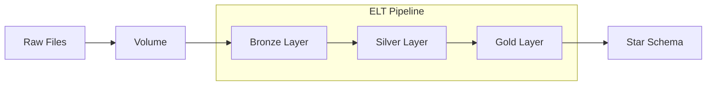

# Databricks End-to-End Data Engineering Project

An end-to-end data engineering project built with **Databricks**, implementing a Medallion Architecture to ingest, transform, and model raw data into an analytical data warehouse.

This project was developed as a hands-on implementation after completing the **Get Started with Databricks for Data Engineering** course.

## Tech Stack

<p align="left">
  
  
  
  
</p>

## Project Architecture

The project follows the **Medallion Architecture**, organizing data into three layers:

| Layer | Purpose |
|---|---|
| Bronze | Stores ingested raw data from source files |
| Silver | Cleans, standardizes, and transforms raw data |
| Gold | Builds dimensional models using a Star Schema for analytical purposes |

## Data Pipeline Workflow

The ELT pipeline consists of three dependent tasks orchestrated using Databricks Lakeflow Jobs.



### 1. Bronze Layer — Data Ingestion

- Created a Databricks Volume to store incoming raw files.
- Ingested raw files into Bronze tables.
- Preserved the ingested data as the foundation for downstream transformations.

### 2. Silver Layer — Data Transformation

- Used PySpark and SQL to clean and transform the Bronze datasets.
- Standardized data structures and prepared datasets for analytical modeling.

### 3. Gold Layer — Dimensional Modeling

- Designed a Star Schema for analytical queries.
- Created dimension tables:
  - `dim_location`
  - `dim_region`
- Created a fact table:
  - `fact_location_metrics`
- Established relationships between fact and dimension tables.

## Workflow Orchestration

The pipeline is deployed using **Databricks Lakeflow Jobs** with three dependent tasks:

```text
01_ingest_raw_to_bronze
          |
          v
02_transform_clean_silver
          |
          v
03_build_star_schema_gold
```

Additional configuration:
- File-arrival trigger to detect new incoming files.
- Task dependencies to control execution order.
- Serverless compute for pipeline execution.

## Learning Outcomes

Through this project, I gained hands-on experience with:

- Databricks workspace and catalog management.
- Lakehouse and Medallion Architecture implementation.
- Data ingestion using Databricks Volumes.
- Data transformation using Python, PySpark, and SQL.
- Dimensional modeling and Star Schema design.
- Workflow orchestration using Lakeflow Jobs.
- Event-driven pipeline execution using file-arrival triggers.

---

**Course:** Get Started with Databricks for Data Engineering

**Platform:** Databricks

